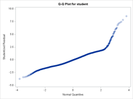
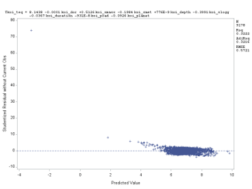

本專案使用 **9,178 筆 Kepler 系外行星觀測資料**，分析恆星與行星特徵與行星平衡溫度之間的關係。

研究重點不只在建立多元線性迴歸模型，也包含資料品質檢查、影響點辨識、變數轉換、模型診斷與樣本外驗證。

本研究為團隊合作成果；共同作者：余洋、張栩、莊凱堯、曾彥博。以下整理為作品集案例，並保留模型推論的限制。

  
觀測資料<strong>9,178</strong>

  
確認不合理觀測<strong>3</strong>

  
Training R²<strong>59.6%</strong>

  
Validation R²<strong>53.4%</strong>

## 研究問題

1. 哪些恆星與行星特徵與平衡溫度具有較明顯的統計關聯？
2. 原始多元線性迴歸模型是否存在異常觀測或模型假設問題？
3. 經資料與模型調整後，模型在未參與建模的資料上是否仍保留合理解釋能力？
4. 對 K2-18b 進行預測時，不確定性有多大？

## 分析流程

1. 探索性資料分析（EDA）
2. 建立多元線性迴歸模型
3. 檢查殘差、共線性與影響點
4. 查核並處理不合理觀測
5. 使用 Box-Cox 轉換改善模型條件
6. 進行模型簡化與變數選擇
7. 使用 70／30 Hold-out Validation
8. 應用模型於 K2-18b

## 影響點與資料品質檢查

原始模型診斷發現明顯的極端 studentized residual，因此進一步檢查潛在影響點與原始資料。先透過影響點診斷找出需要查核的紀錄，再回到原始資料確認其中 **3 筆觀測不合理**，因此予以處理。這項決策依據資料品質查核，而非單純追求較高的模型指標。

  <figure>
    
    <figcaption>處理前：殘差分布存在非常突出的極端觀測。</figcaption>
  </figure>
  <figure>
    
    <figcaption>確認並處理不合理觀測後，極端殘差明顯減少，但尾端仍存在偏離。</figcaption>
  </figure>

處理不合理觀測後，極端殘差明顯減少；然而 Q-Q plot 尾端仍可觀察到偏離，因此後續模型結果仍需在診斷限制下解讀。

## Box-Cox 與模型診斷

研究使用 Box-Cox 分析，最終對反應變數採用對數轉換。模型也檢查了共線性，各解釋變數的 VIF 均低於 10，並進行模型簡化與變數選擇。轉換後的診斷圖仍呈現部分極端觀測與殘差結構，不能視為所有模型假設均已成立。

<figure>
  
  <figcaption>Box-Cox 轉換後的殘差與預測值關係；圖形仍存在部分極端觀測與結構，因此不能視為完全理想的隨機殘差。</figcaption>
</figure>

## Hold-out Validation

處理 3 筆不合理觀測後，以 70／30 分割資料：Training 為 6,423 筆，Validation 為 2,752 筆。

| Dataset | R² | Adjusted R² |
| --- | ---: | ---: |
| Training | 0.59622 | 0.59578 |
| Validation | 0.53443 | 0.53324 |

Training R² 約為 59.6%，Validation R² 約為 53.4%。驗證資料的解釋力較訓練資料下降，但沒有出現非常大的落差，因此模型在未參與建模的資料上仍保留相近程度的解釋能力。**模型約可解釋 53%–60% 的平衡溫度變異。**

## 主要解釋變數

研究結果顯示，較重要的資訊包括行星－恆星距離相對於恆星半徑、過境持續時間、恆星表面重力、恆星質量，以及其他恆星與過境相關變數。**這些結果為統計關聯，不應直接解讀為因果效果。**

## K2-18b：從模型結果看預測不確定性

模型使用以下 K2-18b 輸入資料：

| 變數 | 數值 |
| --- | ---: |
| Planet-Star Distance / Star Radius | 89.065 |
| Stellar Mass | 0.407 |
| Metallicity | 0.111 |
| Stellar Surface Gravity | 4.813 |
| Transit Duration | 2.837 |
| Transit Depth | 3158.03 |
| Has Planet | 1 |

研究另檢查 K2-18b 是否為隱藏外推點：其 leverage（hat value）為 **0.000862**，原資料最大 hat diagonal 約為 **0.0363965**；研究未將 K2-18b 判定為隱藏外推點。

模型反應變數為 **log(Kelvin)**。SAS 的預測結果如下：

| 項目（log scale） | 結果 |
| --- | ---: |
| Predicted log value | 6.0854 |
| 99% CI for mean | 6.0513–6.1194 |
| 99% prediction interval | 4.9247–7.2461 |

書面研究報告列出的 Kelvin 尺度結果：

| 項目 | 結果 |
| --- | ---: |
| 文獻／研究引用的 K2-18b 平衡溫度 | 261.2 K |
| 99% 平均反應信賴區間 | 424.66–454.59 K |
| 99% 個別預測區間 | 137.65–1402.62 K |

平均反應的信賴區間相對集中，但針對單一新行星的 99% prediction interval 非常寬，顯示模型對個別行星預測具有高度不確定性。引用的 261.2 K 落在個別預測區間內，但不在平均反應信賴區間內；這不代表模型能精準預測 K2-18b。

## 模型限制

- R² 約為 53%–60%，仍有相當比例的平衡溫度變異未被模型解釋。
- 殘差診斷仍存在尾端偏離與極端觀測。
- K2-18b 的個別預測區間很寬。
- 模型主要描述統計關聯，不能直接建立因果關係。
- 行星實際表面溫度還會受到大氣等因素影響；平衡溫度不是完整的實際環境溫度。
- 平衡溫度是依物理假設計算的量，部分解釋變數可能與其計算共享資訊；留出驗證若在選模後進行，分數可能偏樂觀。K2-18b 來自 K2 任務，跨資料來源的推論仍需外部檢驗。

## 技術工具

`R` · `SAS` · `Multiple Linear Regression` · `Box-Cox` · `VIF` · `Influence Diagnostics` · `Hold-out Validation`

## 專案結論

本專案的重點不只是建立多元線性迴歸模型，而是完整走過資料檢查、模型診斷、異常紀錄確認、模型調整、樣本外驗證與預測不確定性解讀。結果顯示模型能解釋部分平衡溫度變異，但仍存在殘差結構與個別預測不確定性，因此模型結果需在其適用範圍與限制下解讀。
