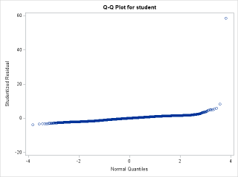

本專案使用 **9,178 筆 Kepler 行星候選者資料**，分析恆星與行星特徵和平衡溫度之間的關係。書面報告所列的分析變數沒有缺值。

研究重點不只在建立多元線性迴歸模型，也包含資料品質檢查、影響點辨識、變數轉換、模型診斷與樣本外驗證。

本研究為團隊合作成果；共同作者：余洋、張栩、莊凱堯、曾彥博。以下整理為作品集案例，並保留模型推論的限制。

  
觀測資料<strong>9,178</strong>

  
確認不合理觀測<strong>3</strong>

  
Training R²<strong>59.6%</strong>

  
Validation R²<strong>53.4%</strong>

## 研究問題

恆星與行星特徵能在多大程度上解釋行星的平衡溫度？模型用於 K2-18b 時，預測又有多大的不確定性？

## 分析流程

1. 探索性資料分析（EDA）
2. 建立多元線性迴歸模型並檢查殘差
3. 依 Box-Cox 分析對平衡溫度進行對數轉換
4. 檢查共線性、影響點，並回查不合理觀測
5. 比較處理前後的模型診斷與評估指標
6. 比較向前、向後與逐步選擇，簡化模型
7. 使用 70／30 Hold-out Validation
8. 應用模型於 K2-18b

## 影響點與資料品質檢查

對平衡溫度進行對數轉換後，研究以 COVRATIO 搭配 studentized residual 檢查影響點，列出 **20 筆潛在影響點**。研究再回查原始欄位，判定其中 **3 筆紀錄不合理**並予以處理；不是僅因模型指標而刪除極端值。

- **第 342 筆：**行星－恆星距離與恆星半徑比值達 79,614；恆星半徑為 0.726 個太陽半徑，但過境持續時間為 9.408 小時、觀測角度為 89.95°。報告綜合這些欄位，認為該筆紀錄可能有問題。
- **第 6,582 筆：**過境持續時間達 138.54 小時；對照行星與恆星半徑、距離比值及觀測角度後，報告判定這組數值不合理。
- **第 7,845 筆：**過境深度為 1,540,000 ppm，超過 1,000,000 ppm（100%），不符合過境深度介於 0 與 1 之間的定義。

  <figure>
    
    <figcaption>處理前：殘差分布存在非常突出的極端觀測。</figcaption>
  </figure>
  <figure>
    
    <figcaption>確認並處理不合理觀測後，極端殘差明顯減少，但尾端仍存在偏離。</figcaption>
  </figure>

報告比較處理前後的常態機率圖及模型評估指標：處理後圖形更接近直線，八變數模型的 R² 從 **0.3222** 提升至 **0.5789**，MSE 從 **0.32734** 降至 **0.20279**。圖形改善不能單獨證明殘差完全符合常態假設，尾端仍需審慎解讀。

## Box-Cox 與模型診斷

原始模型的常態機率圖與殘差對預測值圖顯示誤差假設問題。Box-Cox 分析得到 λ = 0，因此研究改以**平衡溫度的對數**建立模型。報告認為轉換後的診斷圖較符合常態性及同質性；VIF 檢查亦未顯示嚴重共線性。這些圖形與指標是模型診斷結果，不能視為模型已被證明正確。

<figure>
  
  <figcaption>Box-Cox 對數轉換後的殘差與預測值關係；報告以此圖檢視誤差同質性。</figcaption>
</figure>

變數選擇中，向前選擇保留八個變數；向後與逐步選擇均排除**行星半徑**。由於模型評估指標接近，研究選用較精簡的**七變數模型**。

## Hold-out Validation

處理 3 筆不合理觀測後，以 70／30 分割資料：**Training Set（70%，6,423 筆）**用於訓練模型，**Validation Set（30%，2,752 筆）**用於評估模型在未參與訓練資料上的表現。另以 **K2-18b 作為獨立的外部測試案例**，檢視個別預測結果及其不確定性；K2-18b 不計入上述訓練與驗證資料。

| Dataset | R² | Adjusted R² |
| --- | ---: | ---: |
| Training | 0.59622 | 0.59578 |
| Validation | 0.53443 | 0.53324 |

Training R² 約為 59.6%，Validation R² 約為 53.4%。驗證資料的解釋力較訓練資料下降，但沒有出現非常大的落差，因此模型在未參與建模的資料上仍保留相近程度的解釋能力。**模型約可解釋 53%–60% 的對數平衡溫度變異。**

## 主要解釋變數

報告依部分平方和與標準化估計值，指出行星－恆星距離與恆星半徑比值、過境持續時間、恆星表面重力及恆星質量是較重要的解釋變數。**這些結果為控制其他模型變數後的統計關聯，不應直接解讀為因果效果。**

## K2-18b：從模型結果看預測不確定性

模型使用以下 K2-18b 輸入資料：

| 變數 | 數值 |
| --- | ---: |
| Planet-Star Distance / Star Radius | 89.065 |
| Stellar Mass | 0.407 |
| Metallicity | 0.111 |
| Stellar Surface Gravity | 4.813 |
| Transit Duration | 2.837 |
| Transit Depth | 3158.03 |
| Has Planet | 1 |

研究另檢查 K2-18b 是否為隱藏外推點：其 leverage（hat value）為 **0.000862**，原資料最大 hat diagonal 約為 **0.0363965**；研究未將 K2-18b 判定為隱藏外推點。

模型反應變數為 **log(Kelvin)**。SAS 的預測結果如下：

我們採用地球上液態水可能存在溫度範圍做為判斷基準，即為 **175–270 K**；換成自然對數尺度，**log(K) 為 5.1648–5.5984**。

| 項目（log scale） | 結果 |
| --- | ---: |
| Predicted log value | 6.0854 |
| 99% CI for mean | 6.0513–6.1194 |
| 99% prediction interval | 4.9247–7.2461 |

書面研究報告列出的 Kelvin 尺度結果：

| 項目 | 結果 |
| --- | ---: |
| 報告討論引用的 K2-18b 平衡溫度 | 約 261 K |
| 模型點預測值（對數預測值反轉換） | 約 439.4 K |
| 99% 平均對數反應信賴區間（反轉換至 Kelvin） | 424.66–454.59 K |
| 99% 個別預測區間 | 137.65–1402.62 K |

平均對數反應的信賴區間反轉換後相對集中；這不是 Kelvin 尺度下算術平均溫度的信賴區間。針對單一新行星的 99% prediction interval 非常寬，顯示模型對個別行星預測具有高度不確定性。模型點預測約 439.4 K，高於上述 175–270 K 範圍；報告討論引用的約 261 K 落在個別預測區間內，但不在平均對數反應信賴區間的反轉換範圍內。這不代表模型能精準預測 K2-18b。

## 模型限制

- R² 約為 53%–60%，仍有相當比例的對數平衡溫度變異未被模型解釋。
- 殘差診斷仍存在尾端偏離與極端觀測。
- K2-18b 的個別預測區間很寬。
- 模型主要描述統計關聯，不能直接建立因果關係。
- 行星實際表面溫度還會受到大氣等因素影響；平衡溫度不是完整的實際環境溫度。

## 技術工具

`SAS` · `Multiple Linear Regression` · `Box-Cox` · `VIF` · `Influence Diagnostics` · `Hold-out Validation`

## 專案結論

本專案的重點不只是建立多元線性迴歸模型，而是完整走過資料檢查、模型診斷、異常紀錄確認、模型調整、樣本外驗證與預測不確定性解讀。結果顯示模型能解釋部分平衡溫度變異，但仍存在殘差結構與個別預測不確定性，因此模型結果需在其適用範圍與限制下解讀。
