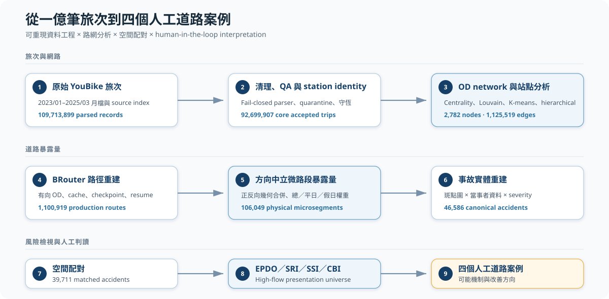
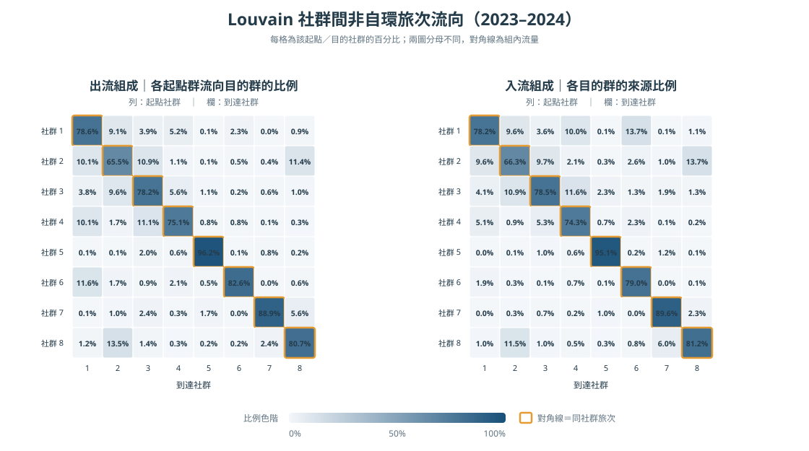
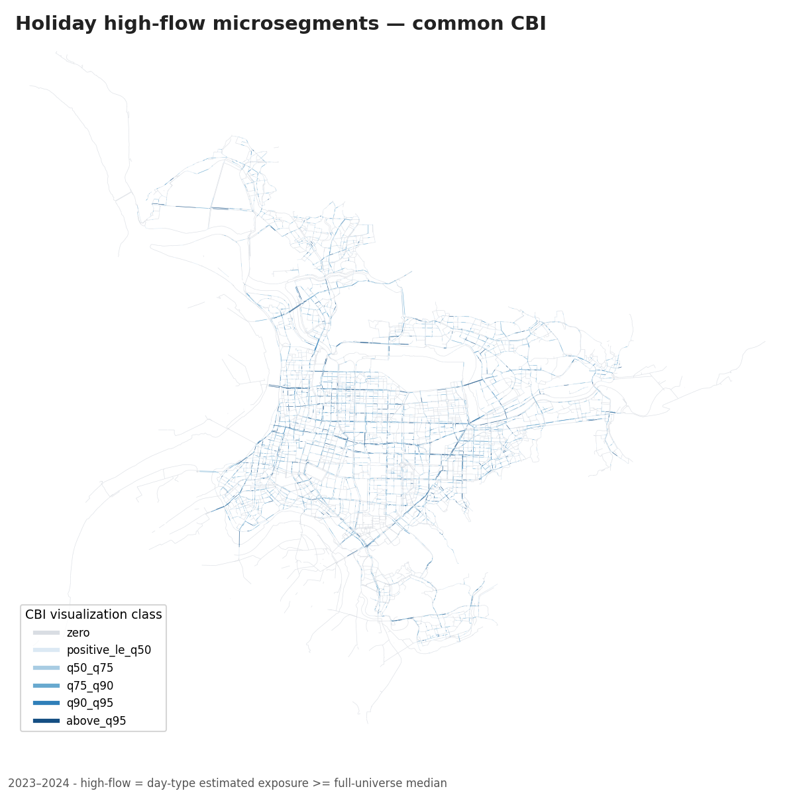
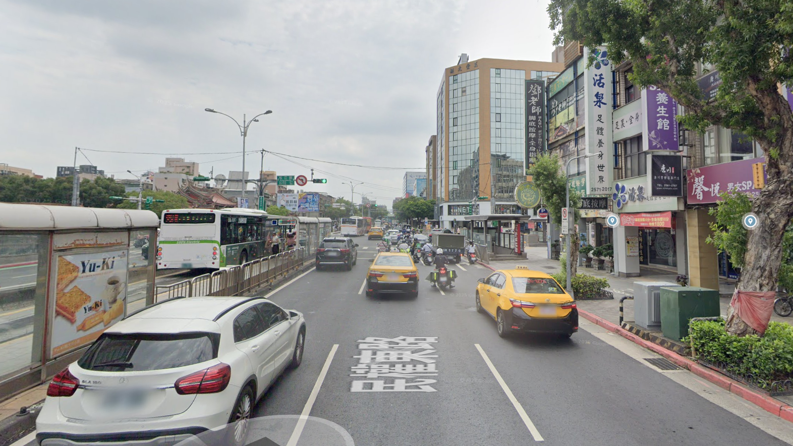
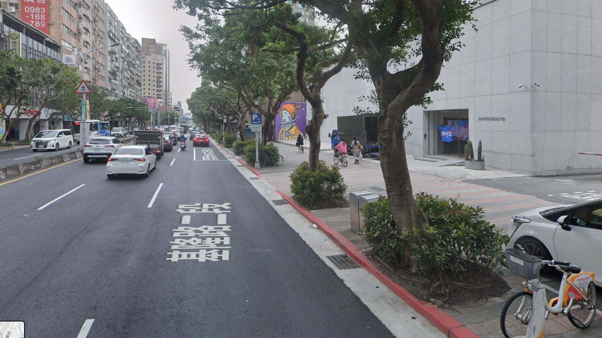
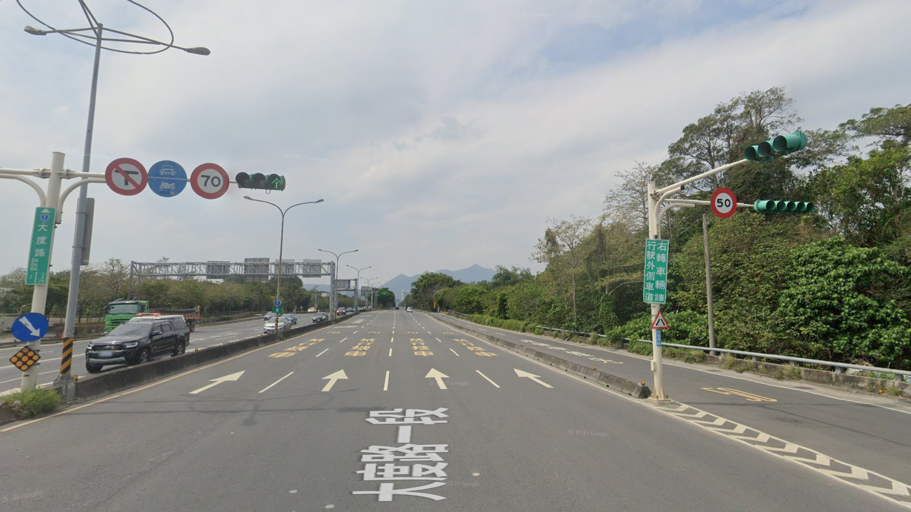

這項研究追問：YouBike 站點的互動結構如何分布？若將站點間旅次投影到道路，事故資料能支持哪些值得進一步現地檢視的問題？

## 研究摘要

- **資料與範圍：**解析 2023 年 1 月至 2025 年 3 月約 1.097 億筆 YouBike 月租借紀錄；核心分析使用 2023–2024 年的 9,113 萬筆可納入旅次，並結合臺北市死傷事故及道路參考資料。
- **方法：**從有向起訖點（origin–destination, OD）網路計算社會網絡分析（social network analysis, SNA）指標與社群，再以固定版本的 BRouter 重建可能路徑，將事故配對至道路微路段，分別觀察事故頻率、嚴重度與估計騎乘暴露量。
- **主要發現：**站點互動形成 8 個 Louvain 社群；各群非自環出流中有 65.5%–96.2% 留在群內，跨群往來仍明顯。46,586 件重建事故中有 39,711 件（85.2%）可依本研究規則配對至道路微路段。
- **解讀界線：**路由與站點座標含重建假設，推估暴露量不是真實 GPS 或道路流量；事故配對與資料涵蓋亦不完整。圖表用來縮小人工檢視範圍，不能作因果或「最危險道路」排名。

[查看 GitHub Repository](https://github.com/kuku0508/YouBike-Road-Risk-Analysis){: .btn .btn--primary }

  

    完整解析旅次
    <strong>109.7M</strong>
  

  

    核心網路站點
    <strong>2,782</strong>
  

  

    道路微路段
    <strong>106,049</strong>
  

  

    事故道路配對率
    <strong>85.2%</strong>
  

## 分析路徑

核心研究期間為 2023–2024 年；完整流程依序涵蓋旅次清理、OD 網路、SNA 與分群、道路路由、事故空間配對，以及風險指標與人工道路檢視。

## 1｜站點網路分析與分群

核心網路由 **91,138,763 筆**可納入分析的旅次組成，包含 **2,782 個站點**與 **1,125,519 條有向 OD 邊**。本研究實際計算 strength、betweenness、eigenvector centrality、PageRank 與 clustering coefficient，而不只停留在 OD 次數彙整。

<figure class="sna-map-figure">
  <iframe title="YouBike 站點網路分群互動地圖" src="/projects/youbike_sna/assets/sna_cluster_station_map.html" loading="eager" style="width:100%;height:850px;border:0;border-radius:12px;" allowfullscreen></iframe>
  <figcaption class="figure-caption">同一張地圖可在右上角切換 Louvain 社群與 K-means 角色分群。各站以分群顏色標示，不列站名；道路底圖由 OpenStreetMap 提供。座標沿用 <code>routing-coordinate-assumption-v1</code> 月級座標重建假設，並非已驗證的歷史位置。</figcaption>
</figure>

### 中心性不是同一種「重要」

**捷運公館站（2 號出口）**的 total strength 最高（1,723,023），亦為 PageRank 最高站點，代表它同時具有大量直接互動與較高的網路影響力；**大龍峒公園**的 betweenness 與 eigenvector centrality 最高，則更接近「位於許多最短路徑之間」及「連到其他重要節點」的結構角色。這也是本研究不以單一流量值替代完整 SNA 的原因。

### Louvain：依 OD 互動形成的地理社群

**分群依據：**以站點間 OD 旅次次數作為連結權重，雙向旅次合併成無向連結，並排除自我旅次後辨識社群。Louvain 以加權模組度（modularity）尋找互動較密切的站點集合，適合在未預設行政區邊界時探索網路結構；分群結果仍會受隨機種子與網路投影設定影響。

以下名稱依既有社群的站點行政區分布與地圖位置，將研究者指定的八個地理名稱對應至社群；名稱用來輔助閱讀，不代表社群只包含該地區，也不是分群時使用的變數。地理分布上，**大安地區**以大安區為主，往永和方向跨市界延伸；**松山信義**集中於市區東側，與信義一帶相連；**臺北核心**以中山、大同周邊為主，跨淡水河連到三重；**新北西南**分布於西側都會帶，並向新莊方向延展。

北側的**淡北地區**沿士林、北投往淡水延伸；南側的**文山新店**沿文山至新店連續分布，跨越臺北市與新北市界；**內湖地區**主要集中在內湖，向中山一帶連接；**南港汐止**集中於東側，並往汐止方向延伸。整體可見部分社群具有地理連續性，也有跨河、跨市界的連結；社群邊界不等同行政區界。

<figure>
  
  <figcaption class="figure-caption">列為起點社群、欄為到達社群；左圖以各起點社群的非自環旅次總量為分母，右圖以各到達社群的非自環旅次總量為分母。橘框對角線代表同社群旅次。分析涵蓋 2023–2024 年 85,115,195 筆非自環旅次。</figcaption>
</figure>

熱圖顯示八個行政區命名社群的最大流向都是群內：各群出流中有 **65.5%–96.2%** 留在同一社群，淡北地區的組內比例最高；但社群並非封閉。松山信義與南港汐止之間雙向各約 **173 萬趟**，松山信義與臺北核心之間雙向約 **164 萬／163 萬趟**，可見明顯跨群往來。

行政區套疊使用內政部國土測繪中心[鄉鎮市區界線（114 年 3 月 18 日版）](https://data.gov.tw/dataset/7441)；2,756 個有座標站點均能落入行政區，另有 26 站因缺少 routing coordinate 未納入地理命名。座標沿用 <code>routing-coordinate-assumption-v1</code>，因此行政區分布是本次重建的空間呈現，不是已驗證的歷史站址。modularity 為 **`Q = 0.63442954`**。

### K-means：依站點指標整理四種網路角色

**分群依據：**每站使用四項標準化指標：總流量（total strength）、介數中心性（betweenness）、群聚係數（clustering coefficient）與 PageRank；採 `k = 4` 作為可解釋的分群設定。

- **群 1「核心樞紐」（60 站）**：流量、介數中心性與 PageRank 都遠高於平均，跨群連結也較明顯；群聚係數最低。
- **群 2「次級樞紐」（347 站）**：整體中心性高於平均，局部群聚程度較低。
- **群 3「一般站點」（939 站）**：流量與中心性接近平均，群聚程度仍偏低。
- **群 4「局部連結站」（1,436 站）**：流量與中心性較低，但局部群聚程度較高。

上述名稱概括全期網路指標呈現的相對角色，不代表地理分區，也不表示群內每個站點都完全相同。

`k = 4` 的 silhouette 為 **0.509820**；但資料驅動的 elbow 指向 `k = 3`、silhouette 最高則在 `k = 2`。因此四群是便於比較站點角色的分析切法，**不是統計上唯一或最佳的群數**。

### 平日與假日：站點的時間角色會重新組合

分層式分群另以平日／假日各 **2,782 × 72** 個小時中心性特徵，使用 Euclidean distance＋Ward.D2，得到平日 5 群、假日 4 群。兩者的一致程度為 **ARI = 0.381598、NMI = 0.456015**：有共享結構，但不是一對一對應，表示站點在通勤日與假日可能扮演不同的時間角色。這項比較描述 2023–2024 年站點的時間型態，不能直接推定個別騎士的出行目的。

## 2｜從 OD 到道路暴露量

公開旅次資料沒有實際 GPS 軌跡，因此使用固定版本的 BRouter Trekking profile 作為可重現的單一路徑基準：每個有向 OD 配對只路由一次，再按旅次數加權道路通過量。選擇固定 profile 能讓路由環境與結果接受版本、雜湊及快取驗證；它並未經騎士 GPS 驗證為實際或最可能路線。最終完成 **1,100,919 條路由**，並將正反方向幾何整合為 **106,049 個方向中立道路微路段**。路徑選擇或座標誤差會傳遞到微路段暴露量，進而影響暴露調整後的比較。

> 這裡的 exposure 是重建路徑通過微路段的加權 traversal，不是真實 GPS 流量、官方交通量或唯一騎士人數。

### 重建路段使用量的空間分布

<figure>
  <iframe title="2023–2024 YouBike 重建路段通過量互動道路地圖" src="/projects/youbike_sna/assets/routing-flow-map-2023-2024.html" loading="lazy" style="width:100%;height:810px;border:0;border-radius:12px;"></iframe>
  <figcaption class="figure-caption">已驗證的 106,049 個方向中立微路段疊在 OpenStreetMap 道路底圖上，可縮放並調整透明度。顏色代表 2023–2024 年 BRouter 重建路徑的估計加權通過次數，不代表實測車流或事故風險；同一旅次會通過多個路段。<a href="/projects/youbike_sna/assets/routing-flow-2023-2024.png">另開靜態總覽圖</a>。</figcaption>
</figure>

## 3｜事故配對與風險檢視

2023–2024 年事故資料重建為 **46,586 個事故實體**，其中 **39,711 件**成功配對至道路微路段（85.2%）。配對採事故點至微路段 10 公尺作為分析門檻；5／20 公尺敏感度檢查分別配對 34,106／41,926 件，顯示結果依距離選擇而變。無法安全判定的案件保留於排除帳；未配對事故若集中於特定道路環境，後續風險呈現可能產生選擇偏誤。

- **相對事故頻率指標（relative frequency index, SRI）與相對嚴重度指標（relative severity index, SSI）：**分別以微路段事故件數及等值財損事故（equivalent property damage only, EPDO）除以全體 106,049 段的對應最大值，讓兩種量綱能在相同範圍比較。**綜合自行車指標（composite bicycle index, CBI）= SRI + SSI**；它不包含 exposure，也不是絕對事故機率。
- **Observed EPDO／1,000 estimated trips：**目前可計算的是 `193 × fatal + 117 × injury`；完整 PDO-only 事故資料未觀察到，不能當作 0。這組權重沿用既有研究設定，其原始文獻與成本基期仍待補證，不據此宣稱為現行最佳權重。
- **高流量呈現範圍：**平日與假日分別以全體微路段 exposure 中位數界定（53,032／53,025 段）。低暴露量會使 EPDO／估計旅次比值極端；使用中位數後，平日 P99 從 195.980 降為 41.443，假日從 100.367 降為 42.810。這是描述性的穩定性證據，仍有尾端，且中位數不是最佳風險門檻。

  <figure>
    
    <figcaption>平日高流量微路段的 CBI 呈現。</figcaption>
  </figure>
  <figure>
    
    <figcaption>假日高流量微路段的 CBI 呈現。</figcaption>
  </figure>

視覺化級距僅用於縮小人工檢視範圍，不代表熱點定義、Top-N 排名或危險程度倍數。

## 4｜從指標回到道路情境

CBI 只負責縮小人工檢視範圍。下列四個案例再把微路段指標放回較大的道路位置，依序整理**資料證據、可觀察道路脈絡、可能機制與改善焦點**；它們不是 Top-N 排名，也不代表已證明事故成因。

  <article class="road-case-card">
    
    

      <h3>A｜民權東路二段</h3>
      
<strong>CBI 0.8947</strong> · 17 件傷亡事故 · observed EPDO 1,989

      
<strong>道路脈絡：</strong>地下道出口、自行車空間、行人與店家活動在短距離內交會，另有停車與外側車流干擾。

      
<strong>可能機制：</strong>多方向互動壓縮反應距離，路側活動又增加橫向衝突的複雜度。

      
<strong>改善焦點：</strong>出口提前導引與緩衝、行人穿越辨識、視距照明及停車干擾管理。

    

  </article>

  <article class="road-case-card">
    
    

      <h3>B｜百齡橋橋頭</h3>
      
<strong>CBI 0.7895</strong> · 15 件傷亡事故 · observed EPDO 1,755

      
<strong>道路脈絡：</strong>多車道橋梁、上坡與高交通量並存，自行車入口雖存在，但駕駛人與騎士可提早辨識的距離有限。

      
<strong>可能機制：</strong>入口辨識偏晚，加上坡度造成的速度差，使轉向與匯入決策更集中。

      
<strong>改善焦點：</strong>將方向資訊前移、延續鋪面標線，並提高入口的可見性與導引連續性。

    

  </article>

  <article class="road-case-card">
    
    

      <h3>C｜基隆路二段</h3>
      
<strong>CBI 0.3684</strong> · 7 件傷亡事故 · observed EPDO 819

      
<strong>道路脈絡：</strong>YouBike 出入口鄰近公車停靠區，外側車流與植栽視線遮擋同時存在。

      
<strong>可能機制：</strong>自行車匯入、公車停靠與外側車流在同一空間疊加，視距不足可能減少預判時間。

      
<strong>改善焦點：</strong>分離或錯開公車與自行車動線、整理視線、增設緩衝等待區與連續匯入導引。

    

  </article>

  <article class="road-case-card">
    
    

      <h3>D｜大度路一段</h3>
      
<strong>CBI 0.6316</strong> · 12 件傷亡事故 · observed EPDO 1,404

      
<strong>道路脈絡：</strong>長直線路段採自行車與機車混合通行，速度差、超車與兩側設施不對稱同時存在。

      
<strong>可能機制：</strong>長距離與有限退出選擇降低修正空間，混合通行則可能增加速度差與超車互動。

      
<strong>改善焦點：</strong>增加安全退出與銜接選擇、提供進入前資訊，並檢視混合通行的超車空間與全程導引。

    

  </article>

四個案例共同顯示：**「有設施」不等於「容易辨識且可安全使用」**。入口能否提早看見、路徑是否連續、與公車／停車／行人空間如何整合，以及騎士是否能安全退出，才是人工現地檢視真正要回答的問題。這些仍是 evidence-guided 的可能機制，不把街景觀察或空間相關性解讀為事故因果關係。

## 未來研究方向（Future Research Directions）

目前只使用 BRouter 的固定路徑。後續可比較多路徑分配與路徑選擇模型，並以獨立的實際騎乘軌跡檢查預測誤差，評估道路暴露量對路由假設的敏感程度。這些模型與驗證尚未在本研究執行。

未來亦可納入天氣、道路設計與交通環境等變數，建立迴歸模型檢查事故分布的關聯；若要辨認肇因並提出具體改善方案，還需處理暴露量測量誤差、未配對事故、混雜因素與現地資料，不能僅以本研究的描述性關聯作因果結論。

## 可重現性與研究界線

專案以 fail-closed 解析、quarantine、record conservation、deterministic fingerprints、machine-readable receipts，以及 BRouter cache／checkpoint／resume 保存資料處理與驗證軌跡。

主要限制包括：路由重建不是真實 GPS 路徑，推估暴露量不等於實測道路流量；事故配對並非 100%，10 公尺門檻帶來空間歸屬不確定性與可能的選擇偏誤；完整 PDO-only 事故資料未觀察到，不能與零事故混同。低暴露量路段的比值較不穩定；臺北市起點資料亦無法代表完整的新北市起點母體。這些描述性結果不能推論道路設計造成事故。

`Python` · `SQL` · `R` · `Pandas` · `PyArrow` · `NetworkX` · `Shapely` · `BRouter` · `Folium` · `Matplotlib` · `Git`

本研究源自資料探勘課程的團隊期末報告。為補足可執行程式碼與驗證紀錄，我重新建立研究流程；本頁只將可追溯的重建結果作為研究證據，尚無法逐項確認與當時團隊實作完全一致。

[查看完整方法、程式碼與驗證紀錄](https://github.com/kuku0508/YouBike-Road-Risk-Analysis){: .btn .btn--primary }

<small>封面使用 MapToPoster 製作；地圖資料 © [OpenStreetMap contributors](https://www.openstreetmap.org/copyright)。</small>

