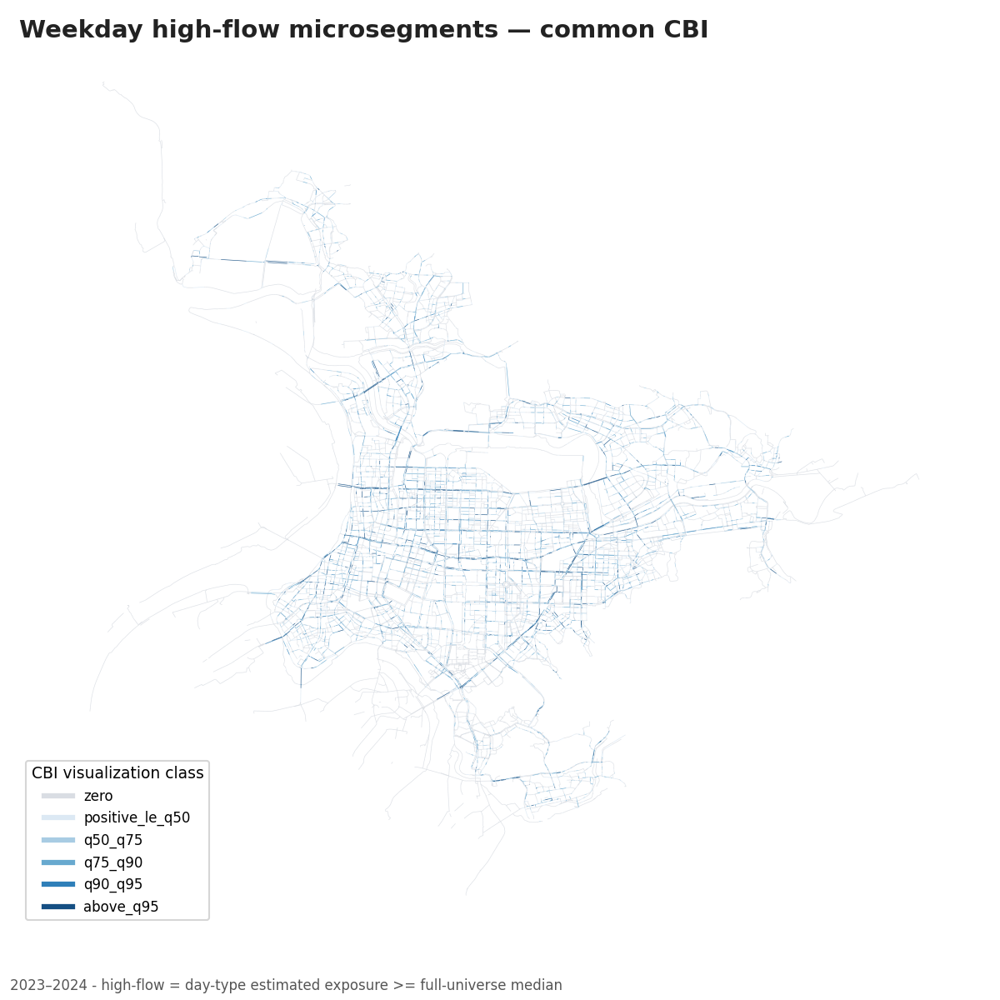
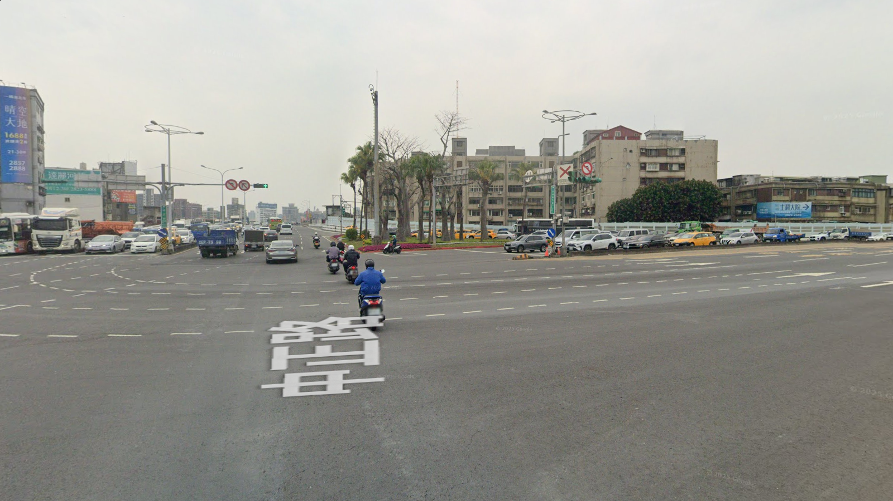

這個專案從超過一億筆 YouBike 旅次出發：先以社會網絡分析（SNA）描述站點互動與分群，再用 BRouter 將 OD 移動轉換成道路層級的估計騎乘暴露量，最後結合 2023–2024 年事故資料進行風險檢視。

> **資料用來縮小值得人工檢視的範圍；道路脈絡用來理解可能的改善方向，而不是產生「最危險道路排名」。**

[查看 GitHub Repository](https://github.com/kuku0508/YouBike-Road-Risk-Analysis){: .btn .btn--primary }

  

    完整解析旅次
    <strong>109.7M</strong>
  

  

    核心網路站點
    <strong>2,782</strong>
  

  

    道路微路段
    <strong>106,049</strong>
  

  

    事故道路配對率
    <strong>85.2%</strong>
  

## 分析路徑

核心研究期間為 2023–2024 年；完整流程依序涵蓋旅次清理、OD 網路、SNA 與分群、道路路由、事故空間配對，以及風險指標與人工道路檢視。

## 1｜站點網路分析與分群

核心網路由 **91,138,763 筆**可納入分析的旅次組成，包含 **2,782 個站點**與 **1,125,519 條有向 OD 邊**。本研究實際計算 strength、betweenness、eigenvector centrality、PageRank 與 clustering coefficient，而不只停留在 OD 次數彙整。

<figure class="sna-map-figure">
  <iframe title="YouBike 站點網路分群互動地圖" src="/projects/youbike_sna/assets/sna_cluster_station_map.html" loading="eager" style="width:100%;height:850px;border:0;border-radius:12px;" allowfullscreen></iframe>
  <figcaption class="figure-caption">同一張地圖可在右上角切換 Louvain 社群與 K-means 角色分群。各站以分群顏色標示，不列站名；道路底圖由 OpenStreetMap 提供。座標沿用 <code>routing-coordinate-assumption-v1</code> 月級座標重建假設，並非已驗證的歷史位置。</figcaption>
</figure>

### 中心性不是同一種「重要」

**捷運公館站（2 號出口）**的 total strength 最高（1,723,023），亦為 PageRank 最高站點，代表它同時具有大量直接互動與較高的網路影響力；**大龍峒公園**的 betweenness 與 eigenvector centrality 最高，則更接近「位於許多最短路徑之間」及「連到其他重要節點」的結構角色。這也是本研究不以單一流量值替代完整 SNA 的原因。

### Louvain：依 OD 互動辨識 8 個社群

**分群依據：**以站點間 OD 旅次次數作為連結權重；雙向旅次合併為無向連結，移除自我迴圈後，依站點間互動強度辨識社群。

- **社群 1：303 站**；站點數最多的城市為臺北市。
- **社群 2：210 站**；站點數最多的城市為臺北市。
- **社群 3：493 站**；站點數最多的城市為臺北市。
- **社群 4：722 站**；站點數最多的城市為新北市。
- **社群 5：342 站**；站點數最多的城市為臺北市。
- **社群 6：209 站**；站點數最多的城市為新北市。
- **社群 7：224 站**；站點數最多的城市為臺北市。
- **社群 8：279 站**；站點數最多的城市為臺北市。

共涵蓋 **2,782 個站點**，modularity 為 **`Q = 0.63442954`**。城市欄只概括各社群中站點數較多的城市；社群仍是依 OD 互動形成，不等同行政區或生活圈。

### K-means：依站點指標整理四種網路角色

**分群依據：**每站使用四項標準化指標：總流量（total strength）、介數中心性（betweenness）、群聚係數（clustering coefficient）與 PageRank；依原報告參考設定重建 `k = 4`。

- **群 1「核心樞紐」（60 站）**：流量、介數中心性與 PageRank 都遠高於平均，跨群連結也較明顯；群聚係數最低。
- **群 2「次級樞紐」（347 站）**：整體中心性高於平均，局部群聚程度較低。
- **群 3「一般站點」（939 站）**：流量與中心性接近平均，群聚程度仍偏低。
- **群 4「局部連結站」（1,436 站）**：流量與中心性較低，但局部群聚程度較高。

上述名稱概括全期網路指標呈現的相對角色，不代表地理分區，也不表示群內每個站點都完全相同。

`k = 4` 的 silhouette 為 **0.509820**；但資料驅動的 elbow 指向 `k = 3`、silhouette 最高則在 `k = 2`。因此四群是為了重建原報告設定而保留的可解釋切法，**不是宣稱統計上唯一或最佳的群數**。

### 平日與假日：站點的時間角色會重新組合

分層式分群另以平日／假日各 **2,782 × 72** 個小時中心性特徵，使用 Euclidean distance＋Ward.D2，得到平日 5 群、假日 4 群。兩者的一致程度為 **ARI = 0.381598、NMI = 0.456015**：有共享結構，但不是一對一對應，表示站點在通勤日與假日可能扮演不同的時間角色。這是 2023–2024 的可重建版本，不宣稱與舊報告中未保存的實作完全相同。

## 2｜從 OD 到道路暴露量

公開旅次資料沒有實際 GPS 軌跡，因此使用 BRouter Trekking profile 重建站點間可能行經的路徑。最終完成 **1,100,919 條路由**，並將正反方向幾何整合為 **106,049 個方向中立道路微路段**。

> 這裡的 exposure 是重建路徑通過微路段的加權 traversal，不是真實 GPS 流量、官方交通量或唯一騎士人數。

## 3｜事故配對與風險檢視

2023–2024 年事故資料重建為 **46,586 個事故實體**，其中 **39,711 件**成功配對至道路微路段（85.2%）。無法安全判定的案件保留於排除帳，不強迫配對。

- **CBI = SRI + SSI**：比較事故頻率與嚴重度的相對位置，不包含 exposure，也不代表絕對事故機率。
- **Observed EPDO／1,000 estimated trips**：以 `193 × fatal + 117 × injury` 除以估計 exposure；PDO-only 資料未觀察到，並非假設為 0。
- 平日與假日分別以 exposure 中位數界定呈現用 high-flow 範圍（53,032／53,025 段），降低極小分母造成的極端值；這不是最佳風險門檻。

  <figure>
    
    <figcaption>平日高流量微路段的 CBI 呈現。</figcaption>
  </figure>
  <figure>
    
    <figcaption>假日高流量微路段的 CBI 呈現。</figcaption>
  </figure>

視覺化級距僅用於縮小人工檢視範圍，不代表熱點定義、Top-N 排名或危險程度倍數。

## 4｜從指標回到道路情境

CBI 只負責縮小人工檢視範圍。下列四個案例再把微路段指標放回較大的道路位置，依序整理**資料證據、可觀察道路脈絡、可能機制與改善焦點**；它們不是 Top-N 排名，也不代表已證明事故成因。

  <article class="road-case-card">
    
    

      <h3>A｜民權東路二段</h3>
      
<strong>CBI 0.8947</strong> · 17 件傷亡事故 · observed EPDO 1,989

      
<strong>道路脈絡：</strong>地下道出口、自行車空間、行人與店家活動在短距離內交會，另有停車與外側車流干擾。

      
<strong>可能機制：</strong>多方向互動壓縮反應距離，路側活動又增加橫向衝突的複雜度。

      
<strong>改善焦點：</strong>出口提前導引與緩衝、行人穿越辨識、視距照明及停車干擾管理。

    

  </article>

  <article class="road-case-card">
    
    

      <h3>B｜百齡橋橋頭</h3>
      
<strong>CBI 0.7895</strong> · 15 件傷亡事故 · observed EPDO 1,755

      
<strong>道路脈絡：</strong>多車道橋梁、上坡與高交通量並存，自行車入口雖存在，但駕駛人與騎士可提早辨識的距離有限。

      
<strong>可能機制：</strong>入口辨識偏晚，加上坡度造成的速度差，使轉向與匯入決策更集中。

      
<strong>改善焦點：</strong>將方向資訊前移、延續鋪面標線，並提高入口的可見性與導引連續性。

    

  </article>

  <article class="road-case-card">
    
    

      <h3>C｜基隆路二段</h3>
      
<strong>CBI 0.3684</strong> · 7 件傷亡事故 · observed EPDO 819

      
<strong>道路脈絡：</strong>YouBike 出入口鄰近公車停靠區，外側車流與植栽視線遮擋同時存在。

      
<strong>可能機制：</strong>自行車匯入、公車停靠與外側車流在同一空間疊加，視距不足可能減少預判時間。

      
<strong>改善焦點：</strong>分離或錯開公車與自行車動線、整理視線、增設緩衝等待區與連續匯入導引。

    

  </article>

  <article class="road-case-card">
    
    

      <h3>D｜大度路一段</h3>
      
<strong>CBI 0.6316</strong> · 12 件傷亡事故 · observed EPDO 1,404

      
<strong>道路脈絡：</strong>長直線路段採自行車與機車混合通行，速度差、超車與兩側設施不對稱同時存在。

      
<strong>可能機制：</strong>長距離與有限退出選擇降低修正空間，混合通行則可能增加速度差與超車互動。

      
<strong>改善焦點：</strong>增加安全退出與銜接選擇、提供進入前資訊，並檢視混合通行的超車空間與全程導引。

    

  </article>

四個案例共同顯示：**「有設施」不等於「容易辨識且可安全使用」**。入口能否提早看見、路徑是否連續、與公車／停車／行人空間如何整合，以及騎士是否能安全退出，才是人工現地檢視真正要回答的問題。這些仍是 evidence-guided 的可能機制，不把街景觀察或空間相關性解讀為事故因果關係。

## 可重現性與研究界線

專案以 fail-closed 解析、quarantine、record conservation、deterministic fingerprints、machine-readable receipts，以及 BRouter cache／checkpoint／resume 保存資料處理與驗證軌跡。

主要限制包括：道路暴露量來自路徑重建、事故配對並非 100%、缺少完整 PDO-only 事故資料、10 m 配對距離與 high-flow 中位數皆為分析決策，以及臺北市起點資料無法代表完整的新北市起點母體。

`Python` · `SQL` · `R` · `Pandas` · `PyArrow` · `NetworkX` · `Shapely` · `BRouter` · `Folium` · `Matplotlib` · `Git`

本研究源自團隊期末專案；本頁呈現的是後續重新建構、驗證與整理後的作品集版本。無法確認的舊實作與目前可重現結果分開處理，不以推測補回遺失流程。

[查看完整方法、程式碼與驗證紀錄](https://github.com/kuku0508/YouBike-Road-Risk-Analysis){: .btn .btn--primary }

<small>封面使用 MapToPoster 製作；地圖資料 © [OpenStreetMap contributors](https://www.openstreetmap.org/copyright)。</small>

