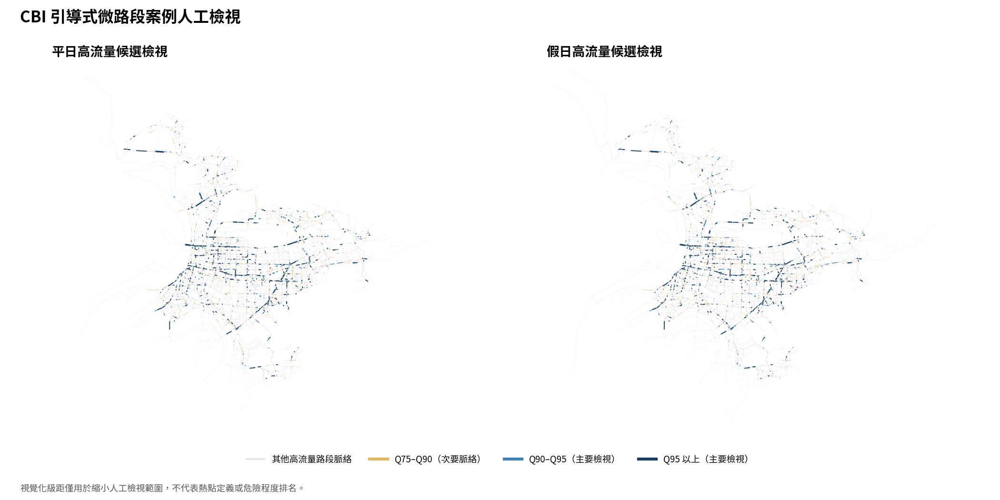

這個專案從超過一億筆 YouBike 旅次出發：先以社會網絡分析（SNA）描述站點互動與分群，再用 BRouter 將 OD 移動轉換成道路層級的估計騎乘暴露量，最後結合 2023–2024 年事故資料進行風險檢視。

> **資料用來縮小值得人工檢視的範圍；道路脈絡用來理解可能的改善方向，而不是產生「最危險道路排名」。**

[查看 GitHub Repository](https://github.com/kuku0508/YouBike-Road-Risk-Analysis){: .btn .btn--primary }

  

    完整解析旅次
    <strong>109.7M</strong>
  

  

    核心網路站點
    <strong>2,782</strong>
  

  

    道路微路段
    <strong>106,049</strong>
  

  

    事故道路配對率
    <strong>85.2%</strong>
  

## 分析路徑

核心研究期間為 2023–2024 年；完整流程依序涵蓋旅次清理、OD 網路、SNA 與分群、道路路由、事故空間配對，以及風險指標與人工道路檢視。

## 1｜站點網路分析與分群

核心網路由 **91,138,763 筆**可納入分析的旅次組成，包含 **2,782 個站點**與 **1,125,519 條有向 OD 邊**。本研究實際計算 strength、betweenness、eigenvector centrality、PageRank 與 clustering coefficient，而不只停留在 OD 次數彙整。

| 分析 | 可重現結果 | 解讀界線 |
| --- | --- | --- |
| SNA 指標 | 捷運公館站（2 號出口）的 total strength 最高（1,723,023），亦為 PageRank 最高站點；大龍峒公園的 betweenness 與 eigenvector centrality 最高 | 各指標回答的「重要性」不同，不能互相取代 |
| Louvain | **8 個 network communities**，modularity `Q = 0.63442954`；2,782 站全數且只被指派一次 | 不把社群直接命名為商業、住宅或通勤生活圈 |
| K-means | 依原報告參考設定執行 `k = 4`，群大小為 **60／347／939／1,436**，silhouette = 0.509820 | 資料驅動 elbow 為 `k = 3`，因此 `k = 4` 是重建設定，不宣稱為最佳群數 |
| 分層式分群 | 以平日／假日各 **2,782 × 72** 小時中心性特徵執行 Euclidean＋Ward.D2；參考切割為平日 5 群、假日 4 群 | 這是 2023–2024 重建版本，不宣稱與舊報告未知實作完全相同 |

這些結果將「流量大」「位於跨區路徑」「連到重要站點」與「具有相似時間輪廓」分開觀察，也為後續道路層級分析補上站點結構脈絡。

## 2｜從 OD 到道路暴露量

公開旅次資料沒有實際 GPS 軌跡，因此使用 BRouter Trekking profile 重建站點間可能行經的路徑。最終完成 **1,100,919 條路由**，並將正反方向幾何整合為 **106,049 個方向中立道路微路段**。

> 這裡的 exposure 是重建路徑通過微路段的加權 traversal，不是真實 GPS 流量、官方交通量或唯一騎士人數。

## 3｜事故配對與風險檢視

2023–2024 年事故資料重建為 **46,586 個事故實體**，其中 **39,711 件**成功配對至道路微路段（85.2%）。無法安全判定的案件保留於排除帳，不強迫配對。

- **CBI = SRI + SSI**：比較事故頻率與嚴重度的相對位置，不包含 exposure，也不代表絕對事故機率。
- **Observed EPDO／1,000 estimated trips**：以 `193 × fatal + 117 × injury` 除以估計 exposure；PDO-only 資料未觀察到，並非假設為 0。
- 平日與假日分別以 exposure 中位數界定呈現用 high-flow 範圍（53,032／53,025 段），降低極小分母造成的極端值；這不是最佳風險門檻。

  <figure>
    
    <figcaption>平日高流量微路段的 CBI 呈現。</figcaption>
  </figure>
  <figure>
    
    <figcaption>假日高流量微路段的 CBI 呈現。</figcaption>
  </figure>

視覺化級距僅用於縮小人工檢視範圍，不代表熱點定義、Top-N 排名或危險程度倍數。

## 4｜從指標回到道路情境

| 案例 | 值得進一步檢視的道路脈絡 |
| --- | --- |
| 民權東路二段 | 地下道出入口、自行車空間、行人與店家活動的交會 |
| 百齡橋橋頭 | 上橋入口的提前辨識、連續導引與速度差 |
| 基隆路二段 | YouBike 出入口、公車與外側車流的匯入交織及視距 |
| 大度路一段 | 長距離混合通行、速度差與安全退出選擇 |

案例只提出可供現地檢視的**可能機制**，不把街景觀察或空間相關性解讀為事故因果關係。

## 可重現性與研究界線

專案以 fail-closed 解析、quarantine、record conservation、deterministic fingerprints、machine-readable receipts，以及 BRouter cache／checkpoint／resume 保存資料處理與驗證軌跡。

主要限制包括：道路暴露量來自路徑重建、事故配對並非 100%、缺少完整 PDO-only 事故資料、10 m 配對距離與 high-flow 中位數皆為分析決策，以及臺北市起點資料無法代表完整的新北市起點母體。

`Python` · `SQL` · `R` · `Pandas` · `PyArrow` · `NetworkX` · `Shapely` · `BRouter` · `Folium` · `Matplotlib` · `Git`

本研究源自團隊期末專案；本頁呈現的是後續重新建構、驗證與整理後的作品集版本。無法確認的舊實作與目前可重現結果分開處理，不以推測補回遺失流程。

[查看完整方法、程式碼與驗證紀錄](https://github.com/kuku0508/YouBike-Road-Risk-Analysis){: .btn .btn--primary }

<small>封面使用 MapToPoster 製作；地圖資料 © [OpenStreetMap contributors](https://www.openstreetmap.org/copyright)。</small>

